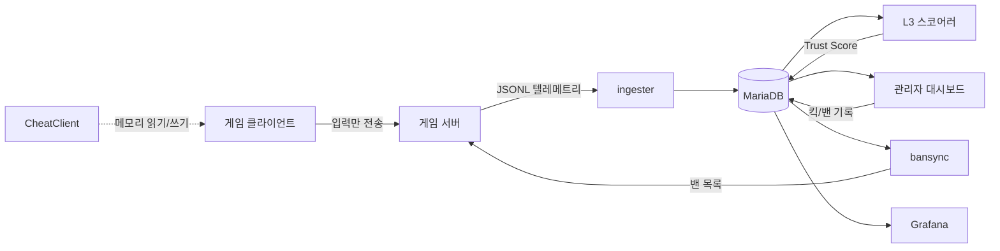

# 서버 권위 FPS 안티치트

**치트 제작 · 실시간 탐지 · 자동 차단**

Unity 멀티플레이 FPS 게임을 직접 만들고, 그 게임을 대상으로 외부 치트를 제작한 뒤, 서버에서 치트를 탐지하고 차단까지 집행하는 안티치트 시스템입니다. 대학교 졸업작품으로 진행했습니다.

> ⚠️ 이 레포의 치트 코드는 **이 프로젝트의 자체 게임만을 대상으로 한 연구·검증용**입니다. 다른 게임이나 서비스에 사용할 수 없으며, 사용해서도 안 됩니다.

<br>

## 개요

클라이언트는 치트 사용자가 완전히 통제하는 환경입니다. 그래서 이 프로젝트는 **클라이언트를 믿지 않는다**는 전제에서 출발합니다.

- 클라이언트는 **입력(이동 · 조준 · 버튼)만** 서버로 보내고, 이동 · 명중 · 체력 판정은 모두 서버가 합니다.
- 메모리를 조작해 판정 자체를 바꾸는 치트는 구조적으로 막힙니다.
- 남은 치트는 입력을 통해서만 영향을 줄 수 있고, 그 흔적은 **행동 데이터**에 남습니다. 서버는 이 행동을 규칙(L2)과 통계(L3)로 탐지합니다.

<br>

## 시연 영상

<!-- TODO: 유튜브 링크로 교체 -->
[시연 영상 보기](https://youtu.be/)

| 장면 | 보여주는 것 |
|---|---|
| 정상 플레이 | 정상일 때는 위반 0건, Trust normal |
| 치트 3종 | 외부 exe로 동작하는 ESP · 에임핵 · 트리거봇 |
| L2 즉시 탐지 | 트리거봇 → V-TIME, 벽 뒤 자동 조준 → V-LOS |
| L3 통계 탐지 | L2 위반이 없는 ESP 사용자가 Trust 단계로 걸림 |
| 차단 | 밴 → 약 1.7초 뒤 추방 → 재접속 거부 |
| 탐지율 탭 | 전체 평가 결과 |

<br>

## 시스템 구조

### 3-Layer Defense

| 계층 | 이름 | 역할 | 상태 |
|---|---|---|---|
| L1 | Client Probe | 클라이언트에서 치트 실행 흔적 감지 | 설계 |
| L2 | 서버 검증 | 입력을 규칙으로 즉시 판정 | 구현 (5종) |
| L3 | Trust Score | 누적 행동 통계로 플레이어 신뢰도 산정 | 구현 |

L1은 우회될 수 있는 계층이므로, **L1이 뚫렸다고 가정하고도 동작하는 서버 쪽 L2 · L3 구현에 집중**했습니다.

### 데이터 흐름



### 인프라

Proxmox 하이퍼바이저(Xeon 12코어 / 32GB / 512GB) 위에 VM 3대를 올리고, VM 간 통신은 Tailscale 메시 네트워크로 연결했습니다.

| VM | 역할 | 실행 서비스 |
|---|---|---|
| VM101 game-server | 게임 서버 | Unity 리눅스 전용 서버, 텔레메트리 ingester, 밴 동기화(bansync) |
| VM102 db-server | 데이터 · 채점 | MariaDB, L3 스코어러(1분 주기 자동 채점) |
| VM103 mon-server | 모니터링 | Grafana, Prometheus, Loki, Promtail |

<br>

## 구현 내용

### 1. 게임 (서버 권위 넷코드)

- Unity 6 LTS + Netcode for GameObjects, 60Hz 고정 틱
- 클라이언트는 입력만 전송하고, 서버가 같은 시뮬레이션을 돌려 위치를 확정
- 히트스캔 명중 판정은 서버가 하며, 지연 보상을 위해 과거 시점 히트박스로 되감아 판정
- 3인칭 캐릭터 모델 · 애니메이션, 탄약 · 재장전, 반동

### 2. 치트 (CheatClient)

게임 프로세스에 **아무것도 주입하지 않는 순수 외부 exe**입니다(WPF, .NET 8). `OpenProcess` / `ReadProcessMemory` / `WriteProcessMemory`와 포인터 체인으로 게임 메모리를 읽고 씁니다. 연결 시 게임 DLL 해시를 대조해 빌드가 바뀌었는지 확인합니다.

| 치트 | 동작 방식 |
|---|---|
| 에임핵 | 적 위치를 읽어 내 조준각 메모리에 직접 기록. 반동까지 미리 보정해 48m에서 3발 3명중 |
| 월핵 (ESP) | 서버가 보내는 벽 뒤 적 좌표를 읽어 투명 오버레이 창에 표시 |
| 트리거봇 | 조준선이 적 히트박스에 닿는 순간 자동 발사 (반응 지연 옵션) |

연사핵 · 스피드핵도 시도했지만, 메모리의 틱 값을 조작해도 서버가 자기 시계로 판정하기 때문에 **서버 권위 구조상 만들 수 없음**을 실측으로 확인했습니다.

### 3. L2 서버 검증 (규칙 기반, 즉시 판정)

| 코드 | 검사 대상 | 방식 |
|---|---|---|
| V-MOVE-01 | 이동 입력 | 토큰 버킷 + 틱 재전송 · 앞지르기 검사 |
| V-FIRE-01 | 발사 속도 | 서버 실시간 기준 토큰 버킷 |
| V-LOS-01 | 시야 | 벽에 가려진 적을 조준으로 따라가는지(차폐 추적), 벽 너머 명중 이중 확인 |
| V-TIME-01 | 반응 속도 | 적이 보인 순간부터 발사까지의 시간이 사람 한계(실효 60ms)보다 짧은지 |
| V-RECOIL-01 | 반동 제어 | 연사 중 조준 높이가 고정된 연속 길이 (노리코일) |

### 4. L3 Trust Score (통계 기반, 누적 판정)

규칙으로는 티가 나지 않는 치트를 여러 발에 걸친 통계로 잡습니다.

| 탐지기 | 지표 | 결과 |
|---|---|---|
| 에임핵 | 맞은 발의 조준오차 표준편차 | 정상 1.6~3.4° vs 에임핵 0.2~0.4°, 겹침 없음 |
| ESP | 차폐 조준율 (벽에 가려 안 보여야 할 적을 조준선으로 겨눈 비율) | ESP 사용자와 일반 플레이어 분리 |

- 정상 데이터의 중앙값 · MAD를 기준선으로, **치트 방향으로만** 얼마나 벗어났는지 점수화하는 robust z-score 방식
- 두 탐지기를 플레이어별 **Trust 0~100**과 **4단계(normal / watch / shadow / banned)**로 통합
- DB 서버에서 1분마다 자동 채점하여 게임 서버 부하와 분리

### 5. 관리자 대시보드 (WPF exe)

- 실시간 위반, 세션, 플레이어(위반 내역 · Trust 점수), 탐지율 · 오탐률 탭
- **킥 · 밴 집행**: 대시보드가 DB에 기록 → 게임 서버의 bansync가 동기화 → 서버가 추방하고 재접속 거부
- 실측 집행 시간: **킥 2.0초, 밴 1.7초**

### 6. 모니터링 (Grafana)

VM 자원, 서버 로그, 위반 통계 추이를 시각화합니다. 대시보드 exe가 플레이어 단위 판단과 조치를 담당한다면, Grafana는 시스템 전체 관측을 담당합니다.

<br>

## 결과

<!-- TODO: 172 · 173 등 마지막 라벨까지 반영한 뒤, 대시보드 탐지율 탭의 최종 숫자로 갱신 -->

### 탐지율 (치터 9명)

| 치트 | L2 | L3 (shadow 이상) | L2 + L3 |
|---|---|---|---|
| 에임핵 | 2/5 | 3/5 | **4/5** |
| 트리거봇 (지연 0) | 2/2 | 0/2 | **2/2** |
| 트리거봇 (지연 150ms) | 0/1 | 0/1 | **0/1** |
| ESP | 0/1 | 1/1 | **1/1** |
| **전체** | 4/9 | 4/9 | **7/9** |

**두 계층은 서로 다른 치트를 잡습니다.** 규칙(L2)이 놓친 조용한 치트를 통계(L3)가 잡고, L3가 보지 못하는 반응형 치트를 L2가 잡습니다.

### 오탐률

| 구분 | 결과 |
|---|---|
| L2 | 1/37 |
| L3 (shadow 이상) | 0/24 |
| L3 watch (감시 단계) | 5/24 — 대부분 예측 사격 · 선조준 세션 |

표본이 작아 퍼센트 대신 인원 수로 표기했습니다. L3 오탐률은 기준선에 사용한 정상 데이터를 포함해 측정한 값입니다.

### 주요 개선 과정

| 문제 | 해결 | 결과 |
|---|---|---|
| V-TIME 오탐 (연사 중 발사를 반응으로 측정) | 연사 중 · 교전 중 발사 제외 게이트 | 오탐률 19.1% → 1.6% |
| V-LOS 오탐 (모서리 대기를 벽 뒤 추적으로 판정) | "따라가는가" 기준으로 판정 재설계 | 모서리 대기 오탐 0건 |
| V-RECOIL 정상 · 치트 분포 겹침 | 지표 3차 변경 (표준편차 → 비율 → 연속 길이) | 정상 1~4 vs 치트 28~290 |
| Isolation Forest가 에임핵 탐지를 뒤집음 | 방향 반영 robust z-score로 재설계 | 정상 · 에임핵 깨끗이 분리 |
| 녹화 중 총알이 벽을 관통 | 서버 명중 판정 · V-LOS 벽 레이어 마스크 수정 | 벽 관통 해결, 트리거봇 반응시간 정상 측정 |

V-RECOIL은 치트보다 먼저 **게임 자체의 탄약 예측 버그**를 찾아내기도 했습니다.

<br>

## 기술 스택

| 분야 | 사용 기술 |
|---|---|
| 게임 | Unity 6 LTS, Netcode for GameObjects 2.x, Unity Transport, C# (Mono) |
| 치트 · 대시보드 | WPF, .NET 8, Win32 API |
| 서버 | Ubuntu 24.04, systemd |
| 데이터 | MariaDB 10.11, Python (ingester, pandas, numpy) |
| 모니터링 | Grafana, Prometheus, Loki, Promtail, Node Exporter |
| 인프라 | Proxmox VE, Tailscale |

<br>

## 폴더 구조

<!-- TODO: 실제 폴더 내용과 맞는지 확인 -->

```
fps-anticheat/
├── game/          Unity 프로젝트 (클라이언트 · 서버 공용)
├── server/        게임 서버 관련 파일
├── analytics/     텔레메트리 ingester, L3 분석
├── sql/           DB 마이그레이션 (001_init.sql ~)
├── infra/         배포 스크립트
├── tools/
│   ├── cheat/       CheatClient (외부 치트, 연구용)
│   └── dashboard/   관리자 대시보드
└── docs/          설계 문서
```

<br>

## 한계와 향후 과제

- **지연을 준 트리거봇**: 반응 지연 150ms를 주면 V-TIME 기준을 넘겨 L2를 통과하고, L3도 반응시간을 발사와 정확히 짝지을 수 없어 탐지하지 못했습니다.
- **ESP와 숙련자의 구분**: 적 위치를 잘 예측해 겨누는 플레이어도 차폐 조준율이 높게 나와 ESP와 구분되지 않습니다. 정보를 조준이 아닌 위치 선정에만 쓰는 ESP는 잡을 수 없습니다.
- **L1 미구현**: 위 두 한계를 완전히 해결하려면 클라이언트 측 검사가 필요합니다. 외부 메모리 치트를 대상으로 게임 프로세스 핸들 검사, 조준값 무결성 검사, 오버레이 창 검사를 L1에 넣는 것이 다음 단계입니다.
- **원리적 차단**: 서버가 보이는 적의 위치만 클라이언트에 보내도록 바꾸면, ESP를 탐지가 아니라 구조적으로 막을 수 있습니다.
- **표본 크기**: 평가 표본이 작아 신뢰구간이 넓고, 매치 단위로 채점해 표본이 적은 판(맞은 발이 적은 판)은 L3 채점이 되지 않습니다. 플레이어 단위 누적 채점이 필요합니다.

<br>

## 팀원

<!-- TODO: 역할 확인 -->

| 이름 | 역할 |
|---|---|
| 임주현 | 인프라, 게임 시스템, L2 서버 검증, L3 Trust Score |
| 안현민 | 서버 구축, 치트 제작, 관리자 대시보드 |
